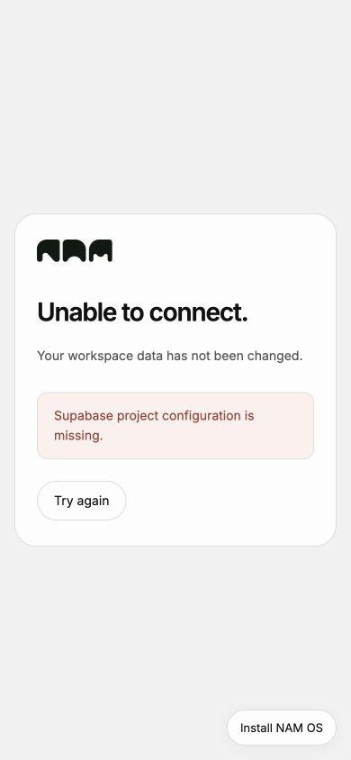
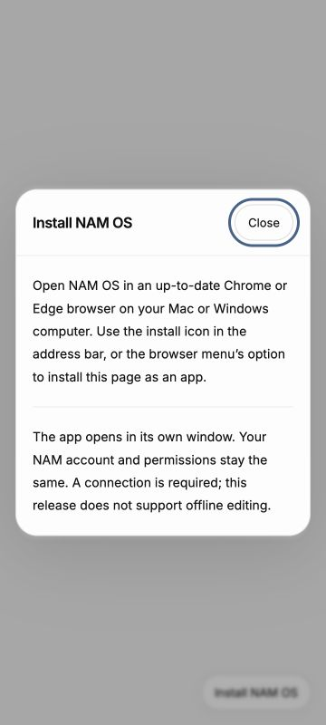

# NAM OS verified development checkpoint

24 November 2026. **Not a production release or a completed full QA cycle.**

The current production source builds and its merged automated suite passes. The tested application source is committed to the NAM-owned GitHub repository; all 125 uploaded files were verified byte-for-byte using the Git tree hash. Supabase/Vercel configuration, real users, tenant integrations and native desktop installation are not verified.

## Executed checks

| Check | Actual result | Practical limit |
| --- | --- | --- |
| Production merged tests | 197 passed, 0 failed, 0 skipped; 8.21 seconds | PostgreSQL/PGlite plus actual TS/API/UI contract tests; controlled provider boundaries |
| Local reference suite | 112 passed, 0 failed | Separate Node/SQLite/provider/UI tests; includes some overlapping production contracts; do not add counts as independent coverage |
| Final optimized build | Passed; Next.js 16.4.6, TypeScript, static generation and server routes | Build success is not hosted behavior |
| Production dependency audit | 0 reported vulnerabilities at all severities | Registry audit is not a security assessment |
| Direct production HTTP checks | 5 passed | No Supabase credentials; nonce CSP/no-store, controlled auth 503, foreign Origin 403, manifest/icons and fonts |
| Rendered browser setup state | No horizontal document overflow at 360, 390, 768, 1024 and 1440 px; logo loaded | Unauthenticated configuration-error state only |
| Install-help keyboard check | Opens modal, Escape closes, focus returns to Install NAM OS | Guidance dialog, not operating-system installation |
| Mobile install help | At 360 px, dialog bounds 17–343 px; no document overflow | Authenticated module/device matrix remains open |
| Browser console sample | No error/warning entries in the bounded sample | Not continuous monitoring or complete console coverage |

Commands use official Node.js 24.22.3:

```sh
npm test
npm run build
npm audit --omit=dev --json
```

The parent suite was executed separately with `node --test --test-concurrency=2 test/*.test.mjs`. Exact logs are `production-test-results.txt`, `build-results.txt`, `dependency-audit.json` and the parent `docs/local-test-results-current.txt`.

## Reproduced defects and verification

| Finding | Correction | Regression evidence |
| --- | --- | --- |
| Task detail selected nonexistent attachment size column | Select physical byte_size, normalize size/status/cleanup metadata | tasks-api.test.mjs executes real selected-column SQL and checks PostgreSQL 42703 canary |
| Direct database MFA/session bypass | Live managed session and elected/required assurance checks | auth-security, context, identity and policy tests |
| Revoked cached founder could reach privileged provider work | Recheck original identity/session and current founder permission after body reads and before privileged phases | Stream/replacement-session/provider-generation adversarial auth tests |
| Unpublished Academy metadata and mutable learning history | Narrow metadata grants, immutable snapshots, pinned enrollments | Academy SQL and dispatcher tests, including revoked TXT downloads |
| Direct upload finalization bypass and replacement race | Validate actual stored bytes; service-only attestation; immutable pending objects | Operations SQL and actual-handler contracts |
| Stale/nullable integration lease and pagination guards | Strict token/limit validation and bounded source pages | Sales SQL, dispatcher and provider fixtures |
| Unready file download links and false success | Readiness/cleanup UI and explicit partial-failure states | Attachment UI contracts |
| Lost course details and stale production owner IDs | In-memory versioned drafts, explicit discard, protected publish/logout, eligible real UUIDs | Actual Academy-controller and workspace VM tests |
| Invented session expiry/history | Explicit provider reporting limitation, no fabricated values | Actual security UI contracts |

A stale message assertion and a TypeScript test-loader syntax mismatch were also corrected; neither was counted as an application behavior defect.

## Eight-user and larger fixture evidence

Eight distinct confirmed synthetic identities cover six role templates. PostgreSQL tests exercise assignments, own-record isolation, stale edits, retry deduplication, independent course completion and membership/session changes. PGlite has one connection: queued offered requests are not simultaneous hosted users.

The same 25-user, 10,000-task, 100-item-page fixture measured read p95 1493.83 ms before migration 011 and 3.17 ms after it. Write p95 after correction was 5.18 ms; maximum summary body remained 50,444 bytes. These are local PostgreSQL/WASM measurements, not hosted latency or capacity. The actual HTTP runner is prepared but has not been run. See eight-user-concurrency.md.

## Rendered evidence






Machine-readable bounded checks are in `evidence/http-boundary.json` and `evidence/responsive-configuration-checks.json`.

## Release gates still open

- Source milestone committed; isolated Supabase staging provisioned and all migrations applied.
- Eight real staging accounts, actual login/logout/MFA/invitation/recovery and direct hosted RLS/Storage tests.
- Real founder and sales browser workflows, supported browser/device/accessibility review and authenticated PWA install/relaunch/update behavior on Mac and Windows.
- Actual integration credentials, entitlements, ownership mapping and reconciliation, or explicitly approved release exceptions.
- Hosted concurrent load, slow/interrupted network cases and independent database plus object restoration.
- Four complete documented cycles and no unresolved critical/high defects in the deployed candidate. **0/4 cycles certified complete at this checkpoint.**
